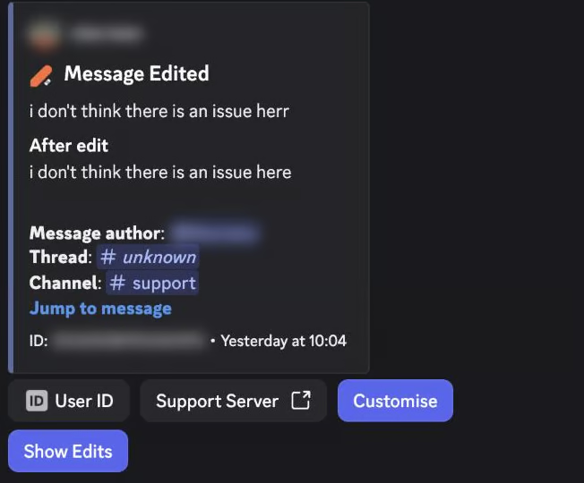
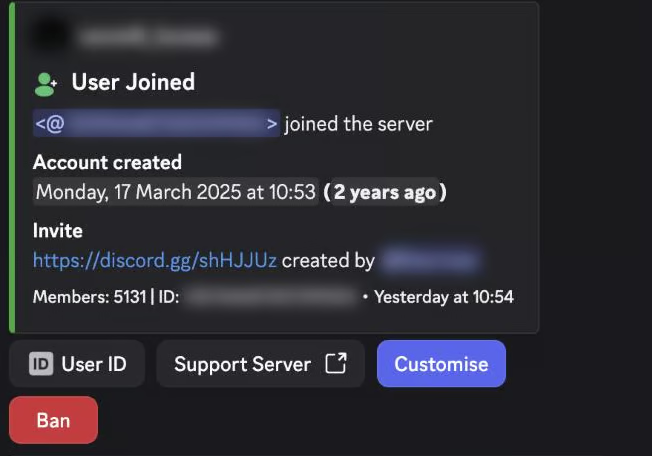
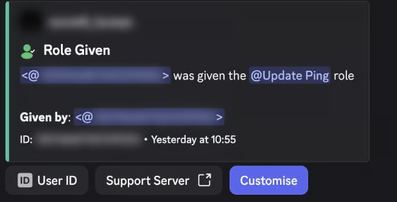
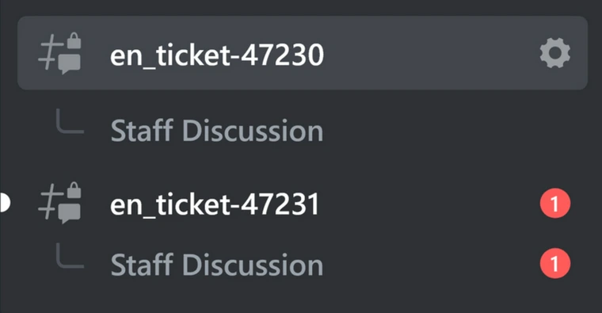
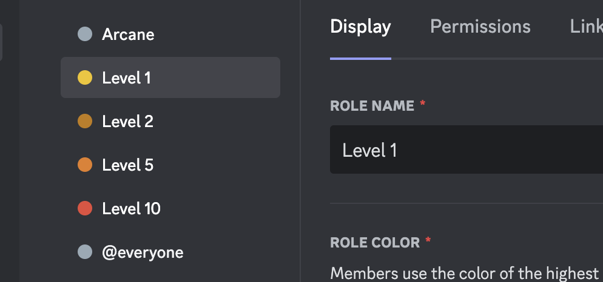
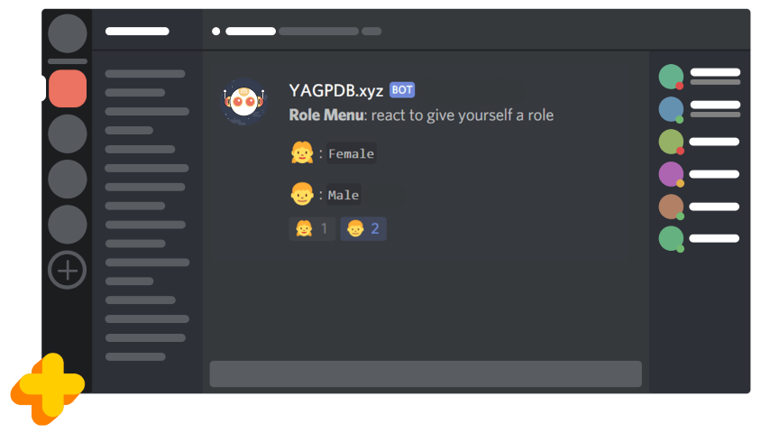
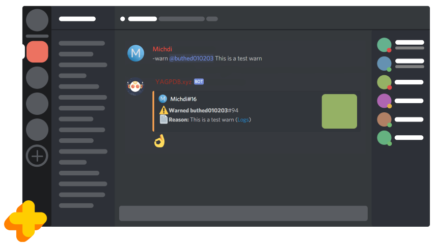

# Evidencia visual y uso permitido en el proyecto

Ocho imágenes inspeccionadas. Abrir [galería local](galeria.html). Se distinguen capturas de Discord, tarjeta, ajustes web e ilustraciones; ninguna acredita por sí sola funcionamiento actual. Las imágenes publicadas por terceros se conservan como referencias de investigación solicitadas por el usuario, con fuente y hash, y no se incluyen en el registro publicable de OBEY. No subirlas como emojis ni a la landing.

Los PNG son copias normalizadas de las imágenes recuperadas, no archivos originales garantizados. Los URL efectivos del CDN de Quark están registrados en referencias.json. Ticket Tool se recuperó desde la imagen webp servida por Imgur. Arcane y YAGPDB conservan sus avisos MIT adjuntos; no se presume licencia libre para las demás imágenes o marcas.

## VIS-01 · Quark · captura publicada de Discord

[Página de procedencia](https://docs.quark.bot/logs/examples). Observado: Antes/después, contexto del mensaje y acciones de consulta. Límite: El servidor ejecutor y la versión desplegada no fueron inspeccionados.

## VIS-02 · Quark · captura publicada de Discord

[Página de procedencia](https://docs.quark.bot/logs/examples). Observado: Título breve, datos de cuenta y origen de entrada. Límite: Una comparación de usos de invitaciones no garantiza atribución individual; OBEY debe admitir desconocido.

## VIS-03 · Quark · captura publicada de Discord

[Página de procedencia](https://docs.quark.bot/logs/examples). Observado: Acción, rol y actor en una jerarquía compacta. Límite: El actor requiere correlación fiable; no se deduce solo por cercanía temporal.

## VIS-04 · Ticket Tool · captura publicada de canales de Discord

[Página de procedencia](https://docs.tickettool.xyz/dashboard/panel-configs/ticket-options). Observado: Hilos del equipo bajo canales de tickets. Límite: La imagen muestra organización de canales; no el mensaje completo ni un cierre probado.

## VIS-05 · Arcane · imagen de tarjeta de rango

[Página de procedencia](https://docs.arcane.bot/plugins/leveling/). Observado: Avatar, nivel, XP, puesto y barra con jerarquía legible. Límite: La barra representa XP, no progreso de reproducción.

## VIS-06 · Arcane · captura de ajustes web

[Página de procedencia](https://docs.arcane.bot/plugins/leveling/). Observado: Configuración de recompensas separada de la tarjeta pública. Límite: No es una interfaz de Discord.

## VIS-07 · YAGPDB · ilustración oficial del cliente

[Página de procedencia](https://yagpdb.xyz/). Observado: Relación visible entre opciones y reacciones. Límite: Ilustración, no captura de producción actual; no copiar sus opciones demográficas.

## VIS-08 · YAGPDB · ilustración oficial del cliente

[Página de procedencia](https://yagpdb.xyz/). Observado: Autor, objetivo y motivo con acento visual. Límite: Ilustración; prefijos y componentes pueden corresponder a una interfaz antigua.

## Traducción al lenguaje visual OBEY

Propuesta: fondo/contexto Discord nativo; títulos breves; un icono funcional; contenido y estado escritos; un acento de marca y acciones pertinentes. Usar #101D36, #FFD36F y #66A8FF. Discord no permite recolorear libremente el cliente o todos sus botones; nuestra paleta se aplica a embeds, imágenes y emojis donde el componente lo admita. No dibujar una captura como si fuera un botón interactivo.

No convertir todos los mensajes en banners. Sanción y logs priorizan datos; bienvenida puede usar tarjeta; música conserva Soundy. La web interna prioriza tipografía y controles: no importar decoraciones de mensajes en cada ajuste.
