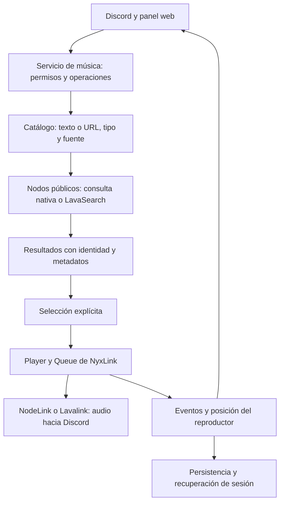

# Sistemas de música: comparación y auditoría de OBEY · 04/11/2026

La conclusión es conservar NyxLink como dueño de la reproducción y unificar el catálogo. Los proyectos revisados separan la resolución de consultas, la decisión de encolar y el avance del reproductor. OBEY ya tiene una cola nativa; la deuda más clara está en los recorridos de búsqueda y en un catálogo heredado que seguía accediendo a una IP externa.

Esta revisión lee código público y documentación oficial. Para servicios privados, los comandos y comportamientos publicados no permiten conocer su motor, sus servidores ni su algoritmo de búsqueda. No se presentan esas partes desconocidas como hechos. [Inventario de veinte archivos y sus commits](evidence/music-architecture-research-20261104.json).

## 1. Bots públicos: construcción comprobada

| Proyecto y revisión | Consulta y catálogo | Reproducción y estado | Patrón útil para OBEY |
| --- | --- | --- | --- |
| JMusicBot · 859e5c58 · 12/08/2024 | SearchCmd solicita resultados a Lavaplayer y presenta hasta cuatro opciones. La elección añade el objeto de pista correspondiente. | PlayerManager integra el motor en Java y crea un reproductor por servidor. AudioHandler es dueño de su cola y responde a los eventos del motor. | Una consulta de búsqueda y la operación de encolar son operaciones distintas. La transición a la siguiente pista procede del evento del reproductor. |
| EvoBot · d7853266 · 06/06/2024 | youtube-sr busca vídeos; el menú entrega URLs al comando play. Song obtiene información y crea el recurso de audio con play-dl. | MusicQueue contiene la cola, un AudioPlayer y la conexión de @discordjs/voice; gestiona Idle, errores y reconexión. | Flujo corto y una cola por servidor. Es una referencia sencilla, no un buscador completo de artistas y álbumes. |
| Red-DiscordBot · 8c726ff4 · 25/10/2026 | AudioAPIInterface separa las consultas, adaptadores de Spotify/YouTube, caché y resolución en Lavalink. | Audio usa un servidor Lavalink gestionado o externo; la cola persistida y los eventos del reproductor tienen componentes propios. | Una frontera clara entre catálogo, caché, persistencia y motor de audio. Es el modelo más cercano al despliegue de OBEY. |
| Muse · fb15afef · 30/10/2026 | GetSongs clasifica texto y enlaces, consulta APIs y convierte metadatos Spotify en candidatos reproducibles. AddQueryToQueue aplica la operación sobre la sesión. | Audio directo desde Node, recuperación de voz separada, identificadores de intento para invalidar trabajo antiguo, sesiones y caché de archivos con SQLite/Prisma. | Control de carreras, publicación ligada a una sesión y recuperación separada. Su motor de audio no es una razón para sustituir NyxLink. |

Fuentes de JMusicBot: [búsqueda](https://github.com/jagrosh/MusicBot/blob/859e5c5862decf433f8face5eaca3372d7d27b22/src/main/java/com/jagrosh/jmusicbot/commands/music/SearchCmd.java), [gestor](https://github.com/jagrosh/MusicBot/blob/859e5c5862decf433f8face5eaca3372d7d27b22/src/main/java/com/jagrosh/jmusicbot/audio/PlayerManager.java), [eventos y cola](https://github.com/jagrosh/MusicBot/blob/859e5c5862decf433f8face5eaca3372d7d27b22/src/main/java/com/jagrosh/jmusicbot/audio/AudioHandler.java).

Fuentes de EvoBot: [búsqueda](https://github.com/eritislami/evobot/blob/d785326612165d83c06a429c1914c76db04005e6/commands/search.ts), [cola y voz](https://github.com/eritislami/evobot/blob/d785326612165d83c06a429c1914c76db04005e6/structs/MusicQueue.ts), [recurso de audio](https://github.com/eritislami/evobot/blob/d785326612165d83c06a429c1914c76db04005e6/structs/Song.ts).

Fuentes de Red: [interfaz de consultas y caché](https://github.com/Cog-Creators/Red-DiscordBot/blob/8c726ff446960a0bf7857b6b94f4a2e05c16c31b/redbot/cogs/audio/apis/interface.py), [cola persistida](https://github.com/Cog-Creators/Red-DiscordBot/blob/8c726ff446960a0bf7857b6b94f4a2e05c16c31b/redbot/cogs/audio/apis/persist_queue_wrapper.py), [eventos Lavalink](https://github.com/Cog-Creators/Red-DiscordBot/blob/8c726ff446960a0bf7857b6b94f4a2e05c16c31b/redbot/cogs/audio/core/events/lavalink.py), [documentación de audio](https://docs.discord.red/en/stable/cog_guides/audio.html).

Fuentes de Muse: [clasificación de consultas](https://github.com/museofficial/muse/blob/fb15afef3733011e59527cdcc4c1cbb9f7709971/src/services/get-songs.ts), [operación de añadir](https://github.com/museofficial/muse/blob/fb15afef3733011e59527cdcc4c1cbb9f7709971/src/services/add-query-to-queue.ts), [propiedad del intento](https://github.com/museofficial/muse/blob/fb15afef3733011e59527cdcc4c1cbb9f7709971/src/services/playback-attempt.ts), [recuperación de voz](https://github.com/museofficial/muse/blob/fb15afef3733011e59527cdcc4c1cbb9f7709971/src/services/voice-connection-recovery.ts), [modelo persistido](https://github.com/museofficial/muse/blob/fb15afef3733011e59527cdcc4c1cbb9f7709971/schema.prisma).

Las fechas son las del commit de cabecera consultado, no promesas de mantenimiento futuro. Las revisiones de JMusicBot y EvoBot son antiguas frente a esta fecha de auditoría. Sus patrones se pueden estudiar; copiar sus dependencias sin comprobar compatibilidad sería otra decisión.

## 2. Servicios estudiados mediante documentación pública

| Servicio | Comportamiento documentado | Qué no está demostrado |
| --- | --- | --- |
| Jockie Music | Búsqueda de canciones, búsqueda específica de álbumes/playlists, elección del proveedor y opciones de inserción/selección. | Lenguaje, librería, propiedad de los nodos, puntuación de relevancia, caché y failover internos. |
| FredBoat | Texto o URL, selección de resultados, comandos de reproducción y cola. Su página premium explica que usa metadatos de Spotify para buscar audio en otras plataformas. | El motor actual de producción, el algoritmo de equivalencia y la topología de servidores. |
| Rythm | /search presenta cinco resultados y un selector; hay controles de cola, permisos DJ, historial y Me gusta. Su documentación distingue también la actividad de Discord. | Implementación del catálogo, estructura de la base de datos, motor de audio y estrategia interna de recuperación. |

Fuentes: [Jockie: comandos](https://www.jockiemusic.com/commands?q=perks), [proveedor predeterminado](https://www.jockiemusic.com/commands?q=next+page), [FredBoat: introducción](https://fredboat.com/docs), [comandos](https://fredboat.com/docs/commands), [metadatos Spotify](https://fredboat.com/premium), [Rythm: comandos](https://docs.rythm.fm/commands/), [actividad y resolución de problemas](https://docs.rythm.fm/troubleshooting/).

La inferencia útil es separar la búsqueda del catálogo de la resolución de audio. No se puede concluir que todos estos bots usen Lavalink, ni que todos los proveedores entreguen las mismas funciones.

## 3. OBEY: lo que ya tiene una responsabilidad clara

- NyxLink 0.1.0-dev.2 crea el Manager, los nodos y los reproductores. Player/Queue conservan la autoridad de cola, historial y autoplay. bindState expone vistas de esos objetos; no es una segunda cola independiente durante la reproducción.
- Las acciones se serializan por servidor. La restauración tras reiniciar guarda cancelaciones y evita que Stop permita recuperar una sesión antigua.
- El estado del panel identifica sesión y revisión, y rechaza actualizaciones antiguas. La publicación de progreso tiene su propio control de frecuencia.
- Los IDs de artistas y álbumes se validan. Spotify y Apple Music mantienen identidades distintas aunque compartan nombre.

Referencias locales: `handlers/music/nodes-runtime.js`, `state.js`, `action-queue.js`, `session-lifecycle.js`, `artists.js`, `dashboard/public/js/player-state.js` y `dashboard/music-realtime.js`.

## 4. Hallazgos concretos

| Prioridad | Hallazgo comprobado | Consecuencia y actuación |
| --- | --- | --- |
| Inmediata | Búsqueda Discord, preview web y un módulo heredado consultaban el catálogo por IP; un YAML conservaba su servicio de tokens. | Dependencia ajena al registro de nodos. Se retiran estos accesos y el módulo heredado sin consumidores activos encontrados en el cargador ni en las importaciones de ejecución. |
| Alta | Artistas y álbumes se deducen en gran parte de pistas/metadatos precargados; la consulta opcional LavaSearch se hace solo con Spotify. | Una pestaña puede responder y seguir ofreciendo un catálogo incompleto. Se necesita una consulta real por tipo, con identidad propia y paginación local sobre resultados comprobados. |
| Alta | La web envía source y kind, pero no los propaga al servicio; node-search solo reconoce guildId, signal y multiple. | La plataforma elegida no gobierna la consulta. Se propone un contrato compartido para Discord y web. |
| Alta | El buscador combina cuatro fuentes y dos nodos antes de ordenar con reglas propias. | Mezcla intenciones y candidatos de distinta naturaleza. Debe existir una fuente efectiva por consulta y un respaldo explícito cuando se use Auto. |
| Alta | El SearchService instalado de NyxLink ya implementa plataforma, respaldos, límites y validación, pero client.music.search utiliza el recorrido REST propio de node-search. | Se duplica parte de la selección y resolución que ofrece la dependencia. La búsqueda de pistas debe integrar el servicio nativo; artistas y álbumes requieren un adaptador pequeño para las respuestas por tipo que el contrato de pistas no representa. |
| Alta | En el recorrido URL, node-search puede fijar un nodo antes de encolar y penalizarlo tras errores de consulta. El preview utiliza ese recorrido. | La exploración puede cambiar preferencias de selección de nodo. Un error del catálogo debe distinguirse de un fallo del transporte de audio. Esta revisión no demuestra que sea la causa de una desconexión concreta. |
| Media | Las búsquedas usan recolectores temporales de 60 segundos y se pierden al reiniciar. | Es válido para un menú temporal, pero debe comunicarse la expiración y ofrecer una nueva búsqueda. Los controles de reproducción y los menús de búsqueda necesitan ciclos de vida distintos. |

Un nodo conectado no demuestra que Spotify, Apple Music, letras y todos sus plugins respondan. Tampoco un ping bajo garantiza buena resolución del catálogo o audio estable. Hace falta comprobar capacidades por fuente y separar catálogo de transporte.

## 5. Arquitectura objetivo conservando NyxLink

El catálogo conserva URI, plataforma, duración e ISRC cuando existen. La reproducción puede resolver el audio en otra fuente; esa equivalencia requiere comprobar la grabación. La interfaz presenta el catálogo elegido y consume eventos/posición del reproductor, sin decidir por su cuenta qué canción está sonando.

La integración propuesta debe mantener desactivados los adaptadores opcionales del cliente que consulten Spotify/Deezer directamente. En la versión instalada están desactivados por defecto y OBEY no los habilita. La fuente de catálogo para este proyecto seguirá siendo el registro de nodos públicos, como solicita el propietario.

NodeLink documenta consultas por tipo; LavaSearch documenta tipos separados. Se comprobaron consultas reales de artistas y álbumes en un NodeLink público, sin entrar en voz. El resultado nativo de artistas no debe tratarse como una canción encolable. [NodeLink](https://nodelink.js.org/docs/api), [LavaSearch](https://github.com/topi314/LavaSearch#api).

## 6. Orden de implementación y estado

1. Retirar la IP, el catálogo y el servicio de tokens antiguos; conservar los campos públicos del preview y comprobar colecciones con nodos. Cambio de esta revisión.
2. Unificar el contrato query/kind/source, integrar la búsqueda de pistas de NyxLink y consultar artistas/álbumes con la API correspondiente. Implementado el 05/11/2026; véase [el contrato](SEARCH-IMPLEMENTATION-2026-11-04.md).
3. Propagar la elección de fuente desde ambas interfaces. Mostrar fuente efectiva y distinguir ready, empty, unavailable y unsupported. Implementado: selector, categorías, reintento y protección frente a respuestas antiguas.
4. Separar fallos de catálogo de salud del nodo de audio y evitar cambios de selección durante un preview. Implementado: las consultas no fijan ni penalizan nodos y los fallos quedan asociados al catálogo.
5. Verificar búsqueda, selección, dos temas consecutivos, Stop durante carga, reconexión y cambio real de nodo con audio. Se conservan las aceptaciones funcionales pendientes del plan; no se cierran por disponer de pruebas unitarias.

La limpieza se valida con regresiones que prohíben el HTTP externo, resolución de álbumes mediante nodos, metadatos públicos y equivalencia de grabación entre nodos. Las pruebas exclusivas del módulo retirado se sustituyen por pruebas del recorrido activo. No se cambia la lista de proveedores permitidos ni se incorpora otro motor de reproducción.

La verificación del rediseño y sus límites están en [la evidencia de implementación](evidence/search-redesign-20261105.json). Los hallazgos de la sección 4 describen la revisión inicial; esta sección indica los cambios posteriores.
