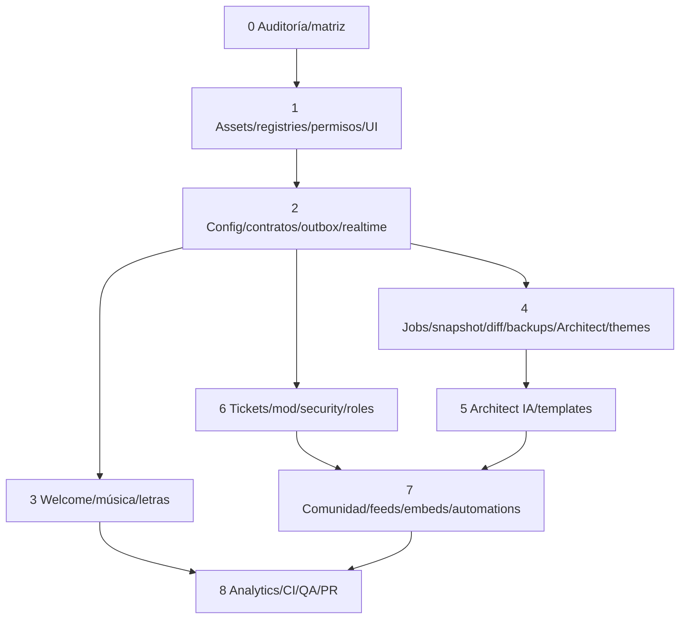

# Plan de implementación de la plataforma OBEY

## 31/10/2026 · clasificación completa y cierre acotado de P0

675 comandos/95 rutas asignados a 27 capacidades; diferencia 674→675 por `slashCommands/setup.js`, sin retiros. Revisión funcional intacta: 51 grupos/168 comandos/21 rutas; los restantes 507/74 conservan fase y tarea. Gate de integridad integrado en CI, 29 casos aislados y 25 tests originales aprobados en host e imagen Node22.23.4; 1.052 hashes y catálogo 675/779/95. Tres pasadas de revisión corrigieron escapes de fase, flags, pertenencia P0 y agrupación de biblioteca. **P0 permanece abierto:** C2 fronteras sensibles/rotación Mongo, C3 sesión y 13 rutas base, C4 documentación G25, C5 aceptación original G01/G02/G25. Los recorridos en dos guilds siguen en P2 y audio/migración en P1. Sin despliegue, reinicio ni operaciones reales de prueba; verificadores temporales retirados. [Informe](../docs/platform/P0-CLOSURE-2026-10-31.md).

## 31/10/2026 · publicación slash confirmada y arranque sin PUT redundante

Código `3295f5c5`, imagen `8b8a55bf89d9`: deployslash exige dueño actual, destino exacto y confirmación; un servidor desconocido nunca pasa a global. Catálogo/registro y autoridad revalidados, transporte de escritura sin reintentos y reserva hasta terminar. Arranque compartido omite PUT si ya coincide: dry-run real e inicio unchanged con 20 raíces/144 invocaciones, sin publicación real de prueba. Cuarenta y cinco casos nuevos y 25 originales pasan en host/imagen; tipos, fronteras y 1.051 hashes. Catálogo 675/779, HTTP 7/7, recursos 13/13 y diez muestras saludables sin reinicios. Respaldos CRC/reversión conservados y temporales retirados. Revisión acotada: último hallazgo de límites corregido con red/green local tras la tercera pasada del catálogo. P0: 51 grupos/168 entradas/21 rutas; quedan 507/74 por revisar. Recibos, G01/G02, aceptación real y P1 siguen abiertos. [Informe](../docs/platform/P0-SLASH-PUBLICATION-2026-10-31.md).

## 31/10/2026 · consolas JavaScript retiradas y dependencia parcheada

Código `cb68e4e9`, imagen `b7b0480c9389`: eval/detailedeval conservan nombres y alias con un aviso para el dueño actual. Se retiraron ejecución de texto y grant por ID histórico; los argumentos no se leen ni pasan al servicio. Veintinueve casos nuevos, dos de redirección y 25 originales pasan en host/imagen, tipos/fronteras y 1.047 hashes; catálogo 675/779. Commit separado actualiza solo follow-redirects 1.16.1→1.16.2; auditoría con 50 moderadas y ninguna alta/crítica. HTTP 7/7, recursos 13/13 y diez muestras saludables sin reinicios; respaldo CRC y reversión conservados, verificadores retirados. Sin comandos ni mensajes reales de prueba. P0: 50 grupos/167 entradas/21 rutas; quedan 508/74 por revisar. Otros eval heredados, Owner/Settings, recibos, G01/G02 y aceptación real siguen pendientes; P1 mantiene su migración y audio real. [Informe](../docs/platform/P0-OWNER-CONSOLE-2026-10-31.md).

## 30/10/2026 · retirada de la recarga en caliente de comandos

Código `5b918853`, imagen `f29da2c49a64`: cmdreload/commandreload y reloadallcmds/reloadallcommands conservan nombres y metadatos con un aviso de migración para el dueño. Se retiró su efecto, que podía quitar un comando al fallar la carga o saltarse las reglas de alias/contenido del arranque. El código se aplica por despliegue; restartbot reinicia la imagen actual con confirmación separada. Veintinueve casos nuevos y 25 originales pasan en host/imagen, tipos/fronteras y 1.045 hashes; catálogo 675/779, HTTP 7/7 y recursos 13/13. Diez muestras saludables con cero reinicios, respaldos CRC y reversión conservados, verificadores temporales retirados. Sin comandos ni mensajes reales de prueba. P0: 49 grupos/165 entradas/21 rutas; quedan 510/74 por revisar. Otros Owner/Settings, recibos, G01/G02, aceptación real y P1 siguen abiertos. [Informe](../docs/platform/P0-COMMAND-RELOAD-2026-10-30.md).

## 30/10/2026 · salida de servidores con confirmación

Código `684848e2`, imagen `59cf89d06f23`: leaveserver/serverleave/kickbot requieren dueño actual, destino exacto y confirmación de un solo uso; revalidan después de entregar el aviso previo. Sin reintentos al quedar la petición incierta; bloqueo retenido hasta terminar y cierre rastreado. Treinta casos nuevos y 25 originales pasan en host/imagen, tipos/fronteras y 1.044 hashes; catálogo 675/779, HTTP 7/7 y recursos 13/13. Diez muestras del nuevo contenedor saludables, cero reinicios. Respaldos CRC y reversión conservados; verificadores retirados, sin salidas ni mensajes reales de prueba. El contenedor anterior tenía un reinicio histórico de causa no acreditada, salida 0 y sin OOM; cinco muestras estables antes de sustituirlo. P0: 48 grupos/163 entradas/21 rutas; quedan 512/74 por revisar. Otros Owner/Settings, recibos, G01/G02 y aceptación real siguen pendientes; P1 conserva la migración musical. [Informe](../docs/platform/P0-OWNER-LEAVE-2026-10-30.md).

## 30/10/2026 · diagnóstico y reinicio controlado del dueño

Código `b9ecc882`, imagen `05e2cf4985fc`: botfilename muestra identidad pública y versiones; restartbot exige dueño actual, confirmación y reserva única antes del cierre sin shell. Stop/reload conservan su desactivación; shutdown continúa tras fallos y espera el Gateway. Bandera de reinicio habilitada tras verificar supervisor always. Veintisiete casos nuevos y 25 originales pasan en host/imagen; tipos, dependencias y 1.042 hashes. HTTP 7/7, recursos 13/13 y diez muestras saludables sin reinicios. Respaldos CRC, reversión y evidencia conservados; verificadores temporales retirados. No se ejecutó un reinicio por comando ni mensajes de prueba en Discord. P0: 47 grupos/162 entradas/21 rutas; restan 513/74 por revisar, sin equivaler a funciones rotas. Otros Owner/Settings, recibos, G01/G02, aceptación real y P1 siguen pendientes. [Informe](../docs/platform/P0-OWNER-OPERATIONS-2026-10-30.md).

## 29/10/2026 · nombre y avatar del bot confirmados

Código `b2c038b9`, imagen `c80fa5e0cf0f`: changename/changeavatar conservan aliases y grant del dueño, con ID exacto y acceso fresco. Respuesta REST explícita, espera de 20 s y bloqueo hasta terminar; fallos de mensajes contenidos. Avatar PNG/JPEG/GIF en memoria, CDN acotado y validación aislada sin credenciales; cuadros GIF completos y bytes de animación conservados. Treinta casos nuevos y 25 originales en host/imagen, tipos/dependencias y 1.038 hashes. HTTP 7/7, recursos 13/13, diez muestras saludables sin reinicios, respaldos CRC y reversión conservados. Temporales e imagen intermedia retirados; no se modificó el perfil real para probar. P0: 45 grupos/158 entradas/21 rutas; quedan 517/74. Otros Owner/Settings, recibos, G01/G02, aceptación real y P1 siguen pendientes. [Informe](../docs/platform/P0-BOT-PROFILE-2026-10-29.md).

## 29/10/2026 · estado del bot persistente y menú con borrador

Código `169a491b`, imagen `aa27bed98286`: changestatus conserva aliases y grant de owner; cinco ajustes con Guardar/Descartar. Revisión y archivo confirmado antes de publicar memoria o solicitar presencia, sin prometer ACK de Discord. Tercer documento separado, añadido desde el proceso detenido sin cambiar los dos anteriores. Controlador único de rotación/publicidad y cierre. Treinta casos nuevos y 25 originales en host/imagen, recreación aislada y compatibilidad con imagen anterior; tipos, dependencias y 1.034 hashes. HTTP 7/7, recursos 13/13, diez muestras saludables sin reinicios, respaldos CRC con tres documentos y reversión conservados; temporales retirados. P0: 44 grupos/156 entradas/21 rutas; quedan 519/74. Restan otros Owner/Settings, recibos, G01/G02, aceptación real y P1. [Informe](../docs/platform/P0-BOT-STATUS-2026-10-29.md).

## 29/10/2026 · ajustes globales persistentes

Código `ca7f1e7a`, imagen `90b117a6dcc5`: prefijo, propietarios, avisos y publicidad usan una proyección privada fuera del contenedor. Inicio estricto antes de consumidores; identidad compartida y materiales actuales conservados. Publicidad restaurada con ActivityType numérico. Copia del origen detenido, directorio 0700/archivos 0600; respaldo posterior con proyección y hashes. Veintiocho casos nuevos y 25 originales en host/imagen, recreación de dos contenedores aislados, recuperación en imagen anterior, tipos/dependencias y 1.030 hashes. HTTP 7/7, recursos 13/13 y diez muestras saludables sin reinicios; respaldo/reversión conservados y temporales retirados. P0 sigue en 43 grupos/155 entradas/21 rutas; quedan 520/74. Restan estado/otros Owner-Settings, recibos, G01/G02 y aceptación real. [Informe](../docs/platform/P0-GLOBAL-CONFIG-2026-10-29.md).

## 29/10/2026 · prefijo global con guardado confirmado

Código `b53bd187`, imagen `62dbf8ca3a01`: changeprefix usa IDs exactos del archivo actual y Administrator/canal/bot frescos; cola compartida, revisión y reemplazo atómico antes de actualizar la memoria. Conserva prefijos por servidor y otras claves. Dieciocho casos nuevos y 25 originales pasan en host/imagen; tipos, dependencias, 1.026 hashes, HTTP 7/7, recursos 13/13 y diez muestras saludables sin reinicios. Respaldo CRC, reversión y evidencia conservados; temporales retirados. P0 sigue en 43 grupos/155 entradas/21 rutas; restan 520/74. Persistencia externa de la configuración global, demás Owner/Settings, recibos, G01/G02 y aceptación real pendientes. [Informe](../docs/platform/P0-GLOBAL-PREFIX-2026-10-29.md).

## 29/10/2026 · resetsettings con dos opciones y transacciones

Código `fffe3b0e`, imagen `f626acbef79c`: botones Solo configuración / Configuración y datos, vista previa y confirmación ligada a esa selección. IDs de owner exactos, transacción snapshot/majority y revisión BSON tipada; diario de mutaciones para conservar escrituras en espera y publicar caché después del commit. Se conservan premium, bibliotecas compartidas, moderación y música avanzada. Veintiocho pruebas nuevas contra Mongo aislado en imagen, 25 originales, tipos, dependencias y 1.024 hashes; HTTP 7/7, recursos 13/13 y diez muestras saludables sin reinicios. Respaldo CRC y reversión conservados; fixture/temporales retirados. P0: 43 grupos/155 entradas/21 rutas, restan 520/74. Recibos, auditoría global, migración de claves antiguas, G01/G02 y aceptación autenticada siguen pendientes. [Informe](../docs/platform/P0-GLOBAL-RESET-2026-10-29.md).

## 29/10/2026 · reset básico con confirmación y guardado condicional

Código `9acbe35c`, imagen `27483e1bb6f5`: reset/hardreset conserva su alcance de nueve campos, confirma con botones de un solo uso y revalida al propietario dentro de la cola. Una escritura atómica precede al éxito; conflictos, cancelación, vencimiento y ACK fallido no anuncian guardado. Dieciocho casos aislados y 25 originales en imagen; tipos, dependencias, 1.021 hashes, HTTP 7/7, recursos 13/13 y diez muestras saludables sin reinicios. Respaldo CRC y reversión conservados. P0: 43 grupos/155 entradas/21 rutas; restan 520/74. Resetsettings global, recibos, G01/G02 y aceptación autenticada siguen pendientes. [Informe](../docs/platform/P0-LEGACY-RESET-2026-10-29.md).

## 29/10/2026 · ecualizador predeterminado conectado al reproductor

Código `c48414be`, imagen `46c47b3a90a3`: defaultequalizer y panel comparten perfiles nativos con CAS, desactivados por defecto; una conexión nueva aplica el elegido. Recuperación/cambio de nodo evitan los valores predeterminados; el efecto no confirmado se indica en reproducción. Dieciséis casos aislados, doce escenarios de navegador, 25 originales en imagen, tipos y dependencias; 1.019 hashes, HTTP 7/7, recursos 13/13 y diez muestras saludables sin reinicios. Respaldo CRC y reversión conservados. P0: 42 grupos/154 entradas/21 rutas; restan 521/74. Reset, recibos, G01/G02 y aceptación autenticada siguen pendientes. [Informe](../docs/platform/P0-DEFAULT-EQUALIZER-2026-10-29.md).

## 29/10/2026 · volumen y autoplay predeterminados compartidos

Código `b889c06a`, imagen `96d593a66433`: comandos y formulario web independiente usan defaultVolume/autoplay con CAS y confirmación tras persistir. Guardar ajustes generales ya no cambia autoplay de la sesión activa. Quince casos aislados, doce escenarios de navegador, 25 pruebas originales en imagen, tipos y dependencias; 1.019 hashes, HTTP 7/7, recursos 13/13 y diez muestras saludables sin reinicios. Respaldo CRC y reversión conservados. P0: 42 grupos/153 entradas/21 rutas; faltan 522/74. Ecualizador antiguo, reset, recibos, G01/G02 y aceptación autenticada siguen pendientes. [Informe](../docs/platform/P0-MUSIC-DEFAULTS-2026-10-29.md).

## 28/10/2026 · roles DJ compartidos

Código `f0602f4c`, imagen `1289a1190d71`: roles DJ compartidos por comandos/panel con CAS y formulario múltiple independiente; sin borrado por caché. Trece casos aislados, trece escenarios de navegador y 25 originales en imagen; 1.015 hashes, HTTP 7/7, recursos 13/13 y diez muestras saludables sin reinicios. Respaldo CRC y reversión conservados. P0: 41 grupos/151 entradas/21 rutas; faltan 524/74. G01/G02, recibos y aceptación autenticada siguen pendientes. [Informe](../docs/platform/P0-DJ-ROLES-2026-10-28.md).

## 28/10/2026 · canales de comandos persistidos

Código `6adb96dd`, imagen `78b4cd73c294`: addbotchat/removebotchat esperan guardado CAS; el router conserva canales ausentes en caché. Diez casos aislados, una regresión de fuente y 25 originales en imagen; 1.009 hashes, HTTP 7/7, recursos 12/12 y diez muestras saludables sin reinicios. Respaldo CRC y reversión conservados. P0: 40 grupos/149 entradas/21 rutas; faltan 526/74. Recibos, G01/G02 y aceptación autenticada siguen pendientes. [Informe](../docs/platform/P0-BOT-CHANNELS-2026-10-28.md).

## 28/10/2026 · borrado de canales y roles

Código `3d62a7b4`, imagen `ee586c109e73`: borrado de canales/roles con acceso fresco, destino exacto y confirmación de roles revalidada. Doce casos aislados y 25 originales en imagen, 1.007 hashes, HTTP 7/7, recursos 12/12 y diez muestras saludables sin reinicios. Respaldo CRC y reversión conservados; sin borrados reales de prueba. P0: 39 grupos/147 entradas/21 rutas, faltan 528/74. G01/G02, recibos y aceptación autenticada siguen abiertos. [Informe](../docs/platform/P0-DELETION-2026-10-28.md).

## Avance P0 · limpieza de mensajes · 28/10/2026

`clear`, `clearbotmessages` y `/purge` comparten permisos actuales, límites de Discord, filtros y conteo confirmado; los fallos parciales se informan. Código `21365849`, imagen `d609d9b0ac00`, 19 casos aislados y 25 originales en imagen, 1.005 hashes, HTTP 7/7, recursos 12/12 y diez muestras saludables. [Evidencia](../docs/platform/P0-PURGE-2026-10-28.md). El mapa cubre 38 grupos/145 comandos/21 rutas; restan 530 comandos/74 rutas. P0 continúa con Administración, recibos, G01/G02 y aceptación autenticada antes de P1.

[Clasificación de lo pendiente](../docs/platform/P0-TRIAGE-2026-10-28.md): el contador incluye comandos de contenido y consultas, además de operaciones de estado. Revisar primero Administración y Settings, mapear los pares prefix/slash y asignar Music al recorrido P1 sin confundir inventario con aceptación.

## Avance P0 · ajustes de hilos · 28/10/2026

Entrar, salir, unirse a todos los hilos activos y borrarlos comparten acceso fresco y confirmación de Discord. La unión masiva informa resultados parciales. Código `8f6e9dee`, imagen `b02393a3a86e`, 14 casos aislados y 25 originales en imagen, 1.003 hashes, HTTP 7/7, assets 12/12 y diez muestras saludables. [Evidencia](../docs/platform/P0-THREAD-ACTIONS-2026-10-28.md). El mapa cubre 37 grupos/142 comandos/21 rutas; restan 533 comandos/74 rutas. P0 continúa con Administración, recibos, G01/G02 y aceptación autenticada antes de P1.

## Avance P0 · modo lento · 28/10/2026

El texto `slowmode` y `/slowmode` comparten validación, permisos frescos y confirmación del valor aplicado por Discord. Código `a6a84bcc`, imagen `029e9d190545`, 37 pruebas, 999 hashes, HTTP 7/7, assets 12/12 y diez muestras saludables. [Evidencia](../docs/platform/P0-SLOWMODE-2026-10-28.md). El mapa cubre 34 grupos/133 comandos/21 rutas; restan 542 comandos/74 rutas. P0 sigue activo con Administración, recibos duraderos, G01/G02 y aceptación autenticada antes de P1.

## Avance P0 · bloqueo de canales · 28/10/2026

Cuatro comandos de bloquear/desbloquear canal comparten servicio, permisos frescos y edición puntual, sin reemplazar las otras sobrescrituras. Código `80bc8eed`, imagen `08bc1522a3b8`, 36 pruebas, 997 hashes, HTTP 7/7, assets 12/12 y diez muestras saludables. [Evidencia y límite](../docs/platform/P0-CHANNEL-LOCK-2026-10-28.md). El mapa cubre 33 grupos/131 comandos/21 rutas; restan 544 comandos/74 rutas. P0 sigue activo con Administración, recibos duraderos, G01/G02 y aceptación autenticada antes de P1.

## Avance P0 · 28/10/2026

La consulta de vetos `bans`/`listbans` entrega solo por DM, con permisos frescos y paginación completa; el respaldo Mongo usa configuración temporal privada. Código `b921791c`, imagen `b12685348616`, 34 pruebas, 995 hashes, HTTP 7/7, assets 12/12 y diez muestras saludables. [Evidencia](../docs/platform/P0-BAN-LIST-2026-10-28.md). Se revisaron 32 grupos/127 comandos/21 rutas; restan 548 comandos/74 rutas. P0 sigue activo con Administración, recibos duraderos, G01/G02 y aceptación autenticada, antes de P1.

## Orden activo · 23/10/2026

La corrección del usuario «sigue un orden en el plan» fija una única secuencia de ejecución. Gobierna el [maestro 0.15](../docs/guia-arquitectura/investigacion-20261022/08_PLAN_DE_EJECUCION.md); los IDs T/ARCH/MOD existentes conservan alcance, dependencias y evidencias. Las entregas siguientes son historial y no cambian la prioridad activa.

| Orden | Etapa | Trabajo y condición de avance |
| --- | --- | --- |
| 1 · activa | P0 · base e inventario | Completar conciliación de comandos, rutas, aliases y propietarios; resolver discrepancias de versiones/lock/CI. Cerrar con evidencia de la base y registro efectivos, no solo inventario de archivos. |
| 2 | P1 · música consistente | Migrar a lavalink-client con una sola autoridad de cola y snapshots compatibles. Verificar fin/skip/stop, modos, autoplay/manual, errores y recuperación; conservar doce controles, favoritos y reloj. |
| 3 | P2 · configuración y gestión | Completar recorridos de setups/configuración, bienvenida, tickets, moderación y logs con permisos y datos reales por recorrido. Aceptación en dos guilds y permisos distintos. |
| Transversal | P3 · recursos e idiomas | Integrar materiales, IDs reales, fallbacks y textos con cada recorrido de P1/P2 y siguientes. No reservarlo para una renovación global al final. |
| 4 | P4 · votos y premium | Contratos, deduplicación, conciliación y derechos en sandbox; sin venta pública automática. |
| 5 | P5 · escalado y recuperación | Drain/takeover, caída de proceso y restauración de datos comprobados antes de ampliar infraestructura. |
| 6 | P6 · ampliaciones | Comunidad, colecciones y automatización con contratos, cuotas, privacidad y aceptación por capacidad. |

### Incidencia musical auditada · 24/10/2026

El usuario solicitó una auditoría y cuestionó la arquitectura durante la unidad Config. [Informe](../docs/platform/MUSIC-AUDIT-2026-10-24.md) y [evidencia](../docs/platform/evidence/music-architecture-audit-20261024.json): respaldos actualmente fallidos, recuperación agotada, pausa retenida por autoplay y prioridad manual incompleta reproducidas. Diagnóstico terminado; [concurrencia y restauración corregidas](../docs/platform/MUSIC-CONCURRENCY-2026-10-25.md) y desplegadas en `6479683`. La migración y los demás hallazgos siguen pendientes. La auditoría inicial fue de lectura y P0/P1 siguen abiertos. Resumen Config y categoría MUSIC se verificaron y desplegaron después en `7828e8c`; los hallazgos se vinculan a P0/P1 sin sustituir la secuencia global.

### Unidad inmediata: cierre acotado de P0 · 31/10/2026

La [clasificación completa y lista de cierre](../docs/platform/P0-CLOSURE-2026-10-31.md) sustituye el seguimiento activo por comandos sueltos. Hay **661 comandos/95 rutas clasificados en 27 capacidades**; la revisión funcional sigue en **51 grupos/168 comandos/21 rutas**. Los otros 493/74 conservan tareas en su fase. No se declara aceptación por inventariar ni se rebaja el contrato de cada operación.

1. **P0-C1 completado:** clasificación exacta, propietarios/hash desde el inventario, diferencia histórica 674−14 retirados+`slashCommands/setup.js`=661, con procedencia de las retiradas, tareas y CI de integridad.
2. **P0-C2 parcial:** fronteras giveaway/servers/loadbackup corregidas y 14 comandos/8 audios retirados, verificados en aislamiento. Sigue abierta la rotación Mongo en el proveedor; no hay permisos de gestión observados ni conector. [Informe](../docs/platform/P0-SECURITY-2026-10-31.md). El negocio completo conserva su fase.
3. **P0-C3 siguiente:** sesión/tenant/CSRF y salida mínima de las 13 rutas base, conciliando la evidencia anterior sin promover las operaciones de negocio.
4. **P0-C4 pendiente:** documentación pública conforme a **G25**, con historia, avisos, exclusiones y soporte reales.
5. **P0-C5 pendiente:** corte de instalación/versiones/lock/CI y loader/registro/aliases conforme a **G01/G02**, más aceptación de G25. Evidencia del corte; separar comprobación local de CI remoto.

**Aceptación de P0:** criterios originales G01/G02/G25 y discrepancias de base resueltas. No exige remodelar primero todos los comandos de P1/P2/P6. Recorridos completos en dos guilds pertenecen a P2; audio y migración a lavalink-client a P1; recibos duraderos conservan sus requisitos por capacidad y recuperación. No se eliminan los pendientes históricos por esta corrección de seguimiento.

### Reglas para las próximas entregas

- Una unidad activa a la vez; verificar, registrar resultado y pendientes, y después avanzar según dependencias.
- Las pantallas Next.js/React se completan junto a su capacidad. El reproductor completo pertenece a P1 y se conectará al contrato y cola canónicos; no inicia ahora una cadena independiente de rediseños.
- El usuario confirmó el 28/10 que, tras cerrar P0 y avanzar P1, quiere un panel web claro y una interfaz `/help` cuidada. Usar los PNG/GIF y referencias actualizados por función, conservando identidad y tipografía; registrar IDs reales y fallbacks antes de publicar materiales.
- Conservar el frontend ya desplegado, datos, identidad y tipografía. La elección de Next.js + React + TypeScript sigue vigente.
- Mantener los tres archivos originales de tests y retirar los verificadores temporales al cerrar cada entrega. Conservar respaldos/reversión y las autorizaciones del usuario; no provocar mensajes, eventos o entradas de voz de prueba fuera del alcance autorizado.
- Una incidencia real se corrige y se registra como excepción concreta; después se retoma la unidad activa. No sustituir el orden por la última pantalla modificada.

## Entregas e instrucciones históricas

### Seguimiento P0 sustituido el 31/10/2026

Texto anterior conservado como historia; sus recuentos y «siguientes» no gobiernan la prioridad actual.

**Entrega 26/10 (logs de moderación):** se unificó el destino heredado `adminlog` con el servicio de logs, se protegieron los detalles según la audiencia y se eliminaron envíos directos de los comandos antiguos. La imagen `433a47555310` está saludable; [informe](../docs/platform/P0-MODERATION-LOGS-2026-10-26.md). El mapa llega a 31 grupos/125 entradas/21 rutas; quedan 550 entradas/74 rutas. Continúan pendientes los recibos duraderos, otras intenciones de Administración, G01/G02 y la aceptación real.

**Entrega 26/10 (silencios):** `mute`, `tempmute`, `permamute`, `unmute` y su vencimiento usan una capacidad compartida con permisos frescos, efecto confirmado, guardado duradero y renovación coordinada. El esquema ya persiste `MUTES`; memoria y Mongo tenían cero registros pendientes antes de reiniciar. [Informe](../docs/platform/P0-ROLE-MUTE-2026-10-26.md). Hay 30 grupos/125 entradas/21 rutas revisadas; faltan 550 entradas/74 rutas. Código `2a89fb30`, imagen `3c93869f7b67` saludable con respaldo y reversión preparados. P0, G01/G02 y la aceptación autenticada siguen abiertos.

**Entrega 26/10:** el historial, creación y retirada de advertencias iniciaron la migración por capacidad a `src/modules/moderation`, con 29 grupos y 121 entradas revisadas y desplegadas en este corte; quedan 554 entradas y 74 rutas. [Evidencia](../docs/platform/P0-WARNING-MODULE-2026-10-25.md). La captura privada del proceso vivo confirmó cero acciones antiguas y cero perfiles con referencias de avisos cargadas; la imagen `4be48604d19b` está saludable con respaldo y reversión verificados. Esto no modifica el orden P0 → P1 → P2, con P3 transversal.

1. Partir del [inventario conciliado](../docs/platform/operation-ownership.json) y la [evidencia P0](../docs/platform/evidence/p0-reconciliation-20261023.json): 675 entradas con adaptador actual, 95 rutas y 779 aliases preservados; runtime vigente en [source.json](../docs/platform/source.json).
2. Ampliar el [mapa de 31 grupos revisados](../docs/platform/shared-intents.json). Idioma, prefijo, roles, resumen Config, categoría MUSIC y los 52 adaptadores legacy de `commands/Setup` ya están trazados; la navegación setup está conciliada en aislamiento. Añadir/quitar roles individuales ya espera el resultado de Discord, y la autorización no elimina concesiones por ausencia de caché. Los ocho comandos de roles masivos esperan sus resultados y comparten admisión por servidor en este proceso; la recuperación duradera sigue en P2. Desbanear texto/slash comparte servicio y separa confirmación de Discord e historial, con acceso fresco y políticas nativas conservadas. Ban/idban/useridban y slash comparten ejecución, permisos/jerarquía actuales y confirmación; se conservan sus historiales diferenciados. Kick/timeout texto-slash y removetimeout prefix comparten acceso/efecto confirmado, conservando grants y diferencias de duración/estado; retirada cierra historia activa con corte temporal. Los logs de moderación comparten destino y política de visibilidad; los recibos duraderos siguen pendientes. Quedan 550 entradas y 74 rutas por revisar. El siguiente bloque continúa con las intenciones pendientes de `commands/Administration` y recibos. El modo 24/7 mantiene sus casos de conexión/almacenamiento en P1. Revisar por intención compartida prefix/slash/web la autoridad de permisos, servicio y repositorio. Registrar diferencias deliberadas y tareas de migración; un adaptador localizado no equivale a servicio canónico ni aceptación funcional.
3. Mantener las comprobaciones de fuentes, aliases y manifests en CI y el contrato aislado de instalación musical. Las seis dependencias directas se declararon sin cambiar versiones/integridades instaladas; lavalink-client aún no está en producción.
4. Conciliar G01/G02 con los IDs originales y su evidencia antes de cerrar P0 y avanzar a P1.

**Aceptación de esta unidad:** propietarios/discrepancias trazables y evidencia vinculada a los IDs existentes; instalación y comprobaciones apropiadas de la base; ninguna capacidad marcada funcional solo por aparecer en el inventario. Después se ejecuta el primer recorrido de migración de P1.

Los «siguientes» de este historial describen su momento. La prioridad actual se consulta únicamente en **Orden activo** y en la cabecera de `tasks/todo.md`.

Decisión del usuario 23/10/2026: frontend Next.js + React + TypeScript. Migración por pantalla bajo /app, conservando backend Express, OAuth, CSRF, servicios, Socket.IO, tipografía y landing. Primera unidad: contexto de sesión/servidores autorizado, selector, estado/controles básicos de música en vivo y accesos a recorridos existentes. Next compila salida estática servida en el mismo origen; el backend mantiene la autoridad. No exige reescribir el bot ni activa un segundo gestor musical. Aceptación: build/tipos, sesión ausente y permiso retirado, sin datos de otras guilds o tokens OAuth, CSRF, desconexión, cambio de servidor, móvil/teclado y navegador real.

Biblioteca/Me gusta desplegados en `b31c65b`: [alcance y evidencia](../docs/platform/FRONTEND-NEXT.md). Colecciones personales y top autorizado, corazones y reproducción por servicios existentes; doce casos temporales, 22 escenarios de navegador sobre Docker y 25 originales pasan. Siguiente frontend: reproductor completo. El resto del plan y P0/P1 musical conservan su alcance.

Configuración/bienvenida desplegadas en `d5897e3`: [alcance y evidencia](../docs/platform/FRONTEND-NEXT.md). Diez casos temporales, 22 escenarios de navegador sobre imagen Docker y 25 originales pasan. Navegación central y canal/mensaje con borrador, revisión y publicación canónica; otros ajustes permanecen en EJS. Siguiente frontend: biblioteca/Me gusta, después reproductor completo. P0/P1 musical y las demás tareas conservan su alcance.

Primera pantalla desplegada en `6877829`: [alcance y siguientes pantallas](../docs/platform/FRONTEND-NEXT.md). Selector autorizado, música en vivo y enlaces a recorridos existentes; 18 escenarios de navegador sobre imagen Docker, 12 casos temporales y 25 originales pasan. La migración completa de EJS permanece abierta. La entrega siguiente añade configuración/bienvenida con el contrato y servicio actuales.

Avance activo `7801061`: [registro cargado y fachada musical](../docs/guia-arquitectura/modulos/music.md). Se conciliaron 531 prefix/144 slash/779 alias y se unificaron seek/letras. Siguiente: retirar accesos SDK de join/move/reconnect, dispatchers, diagnóstico y cierre antes de transferir la cola al cliente elegido; P0/P1 globales siguen abiertos.

Auditoría de búsquedas desplegada `ce546e8`: [hallazgos y aceptación](../docs/guia-arquitectura/RELEVANCIA_Y_RECOMENDACIONES.md). Catálogo/selector unificados, páginas, permisos y caché; P0/P1 globales y migración siguen abiertos.

P1 parcial desplegado en `6d5b666`: [continuidad y recuperación](../docs/guia-arquitectura/CONTINUIDAD_Y_RECUPERACION.md), sin ciclos de voz durante la ventana observada. La siguiente unidad es inventariar consumidores de Shoukaku y migrar al cliente elegido con cola única y paridad comprobada; siguen abiertas aceptación P0/P1 y escucha real.

Prioridad vigente del 23/10/2026: [entrega 0.15 conciliada](../docs/guia-arquitectura/CONCILIACION_2026-10-23.md), con P0 de base/inventario parcialmente comprobado y P1 de continuidad/migración a lavalink-client como siguiente unidad. Los checkpoints anteriores conservan avances y fechas.

Corrección urgente solicitada después de la recepción: [relevancia y gustos](../docs/guia-arquitectura/RELEVANCIA_Y_RECOMENDACIONES.md), desplegada en c5033b7. Cuatro proveedores, listas pertinentes y recomendaciones por semilla/Me gusta; conservar pendientes de escucha real y continuar P0/P1 del maestro.

Prioridad anterior del 18/10/2026: [facilidad de uso de setups](../docs/guia-arquitectura/FACILIDAD_SETUP.md), solicitada después de desplegar los 63 adaptadores. Entrada única `!setup`, navegación por el mismo mensaje, regreso y rutas básicas sobre los servicios existentes. Continuar las tareas globales pendientes al completar esta corrección; las entregas anteriores que siguen se conservan como historial.

Preferencia de nombres del usuario: archivos por función, sin el prefijo `module-` (por ejemplo, `cards.js`, `configuration-service.js`, `configuration-editor.js`, `feature-registry.js`). La interfaz nombra directamente Bienvenida, Tarjetas y cada función; evita «módulo» en títulos y mensajes. Las futuras entregas siguen esta convención.

Siguiente entrega activa (13 de octubre): ayuda contextual sobre comandos cargados, schemas slash y aliases efectivos. Filtrar contexto/permisos actuales, administrar navegación más allá de 25 categorías y revalidar pertenencia al utilizar controles. Conectar prefijo y `/info help` al mismo servicio y catálogo; slash privado. Exponer consulta equivalente en el dashboard autenticado sin ejecutar comandos desde la ayuda. Verificar permisos revocados, alias, consultas, límites de componentes, concurrencia y frontend con fixtures; no publicar comandos ni reiniciar producción. Configuración/habilitación de todas las utilidades y renderer de tarjetas conservan sus tareas posteriores.

## Renovación con el paquete consolidado (12 de octubre de 2026)

Fuente vigente: `/home/OBEY_Documentacion/INICIAR_CODEX.md`, decisiones y contratos del paquete. Continuar el mismo proyecto y las tareas existentes; conservar todos los cambios locales de bienvenida/Architect. Primera entrega: integrar materiales seleccionados en el registro actual, resolver alias y fallbacks, y adaptar la sincronización PNG/GIF. Mantener el lector del mapa v1 y los doce controles `mp_*`; nuevos mapas v2 usan claves canónicas sin borrar recursos anteriores. No subir emojis ni arrancar producción durante esta entrega local. Siguientes dependencias: capacidades, configuración versionada, ayuda y tarjetas. Evidencia y límites por entrega en `docs/platform/REMODELACION.md`.

Segunda entrega: normalizar capacidades del registro actual sin inicializar handlers nuevos; integrar bienvenida como primer consumidor de borrador/publicación por módulo. Mantener aliases y validación existentes. Borrador y publicación viven en el mismo documento Guild para comparar y guardar atómicamente, sin transacciones entre colecciones. Publicar valida revisión publicada y de borrador, permisos frescos y canal real; guardar borrador no cambia runtime. API/página nuevas comparten servicio con la bienvenida existente. Los campos soportados inicialmente son canal y mensaje; tarjetas, DM y otros ajustes heredados se conservan. Verificar conflictos entre procesos con Mongo aislado y recorrer el editor en navegador.

Workspace activo: `/home/OBEY-YOUR-MASTER`, rama `feature/obey-main-implementation`. La copia `/home/obey-platform-work` es histórica; continuar directamente en el proyecto principal según la corrección del usuario. Estado exacto en `docs/platform/CHECKPOINT.md`.

Alcance inicial, anterior a las autorizaciones posteriores de despliegue y migración frontend del usuario: el maestro integral gobierna los siete antecedentes y recursos aprobados. El trabajo autorizado en ese momento comprendía desarrollo incremental, documentación, pruebas y PR hacia `feat/motor-soundy`; no comprende merge/deploy, cambios sobre servidores reales de usuarios, restauraciones reales ni gasto externo. Landing conservado; identidad web existente y personaje aprobado dentro de Discord.

## Decisiones y dependencias

CommonJS/Express/Mongo se conservan. El frontend migra por capacidad a Next.js + React + TypeScript; EJS mantiene las pantallas pendientes. Shoukaku sigue en producción como origen de la migración a lavalink-client fijada en la edición 0.15. Manifest/servicios/repositorios/contratos se introducen en la parte modificada; sin reorganización masiva ni adapters vacíos. Discord mantiene autoridad de recursos; Mongo mantiene configuración/datos OBEY; Redis coordina estado temporal, locks y cola durable tras ADR. Los handlers Discord y HTTP llaman al mismo servicio y proyección de estado. Cada slice conecta permisos, persistencia, errores, HTTP/eventos/web y tests de ese dominio.

## Estrategia de entrega

Primera entrega: registry/pipeline offline reproducible y fallbacks en controles musicales activos (T02–T04), con T01 completado como auditoría estática. No llamar completa a la fase 1 ni a la plataforma. Cada tarea toca como objetivo 3–5 archivos: los paths nuevos son previstos, los existentes son evidencia; si la implementación exige más, subdividir manteniendo IDs y alcance. Permisos/contratos/shared-state se ejecutan secuencialmente. Las slices incluyen UI web del dominio; no postergarla toda hasta fase 8.

Requisitos trazados en `docs/platform/requirements.json`: 148 bloques íntegros OBEY-SS-BB. Estado pendiente hasta aceptación completa; la carga local de schemas no prueba ejecución real en Discord. T02/T03/T04 implementados y verificados localmente; T19 Discord adelantado como corrección aislada. Siguiente: T05/T06/T07/T12 según CHECKPOINT, manteniendo T19 web explícito. Tras cada checkpoint registrar comandos exactos/resultados, diff, requisitos cubiertos y pendiente ejecutable.

## Riesgos y mitigaciones

| Riesgo | Mitigación |
|---|---|
| Config SyncMap y writes directos web divergen | Servicio canónico/precedencia/await en T12; contract tests dos interfaces |
| Socket mantiene permisos antiguos | Autorizar/revalidar/revocar T06/T15 y probar denial/reconexión |
| Acciones repetidas por retry/worker | Idempotency key, logical ID mapping y verificar estado real antes de crear |
| Restauración destructiva/conflicto | Revisión ligada snapshot, backup completo, rollback limitado propuesto |
| Mongo sin transacciones | Verificar deployment aislado; diseñar recuperación/outbox compatible antes de prometer atomicidad |
| Credenciales o intents ausentes | Estado unconfigured/unavailable y completar vías offline/visuales independientes |
| Helpers fuente incorrectos | Adaptar y validar builders/rutas/dimensiones/versiones reales; fuentes originales intactas |
| Alcance pierde módulos durante sesiones | Matriz íntegra y todos checkpoints/task IDs estables; nada excluido por ser nuevo |

## Pendientes de entorno

Pruebas Discord Gateway/REST/OAuth real, browser, DB/Redis/worker y Docker se ejecutan solo contra fixtures/entorno aislado o servidor canary expresamente autorizado. No usar la configuración producción por defecto. Verificar límites/formatos actuales en documentación primaria cuando se implementen. Credenciales IA/emojis/integraciones no necesarias para completar dry runs, fallback, modo visual ni tests con dobles.

## Lista ordenada de tareas

- Fase 0 — [T01: Auditoría y matriz íntegra](todo.md#t01)
- Fase 1 — [T02: Asset Registry y validación offline](todo.md#t02)
- Fase 1 — [T03: Sincronización idempotente de emojis](todo.md#t03)
- Fase 1 — [T04: Fallbacks en doce controles activos](todo.md#t04)
- Fase 1 — [T05: Manifest y registro incremental](todo.md#t05)
- Fase 1 — [T06: Permisos compartidos por acción](todo.md#t06)
- Fase 1 — [T07: OAuth/API y exposición de datos](todo.md#t07)
- Fase 1 — [T08: Router y estado de interacción](todo.md#t08)
- Fase 1 — [T09: Discord UI Kit y preview](todo.md#t09)
- Fase 1 — [T10: Tokens/primitivas web y accesibilidad](todo.md#t10)
- Fase 1 — [T11: Help y setup desde registros](todo.md#t11)
- Fase 2 — [T12: Configuración canónica y precedencia](todo.md#t12)
- Fase 2 — [T13: Envelope/contratos y auditoría](todo.md#t13)
- Fase 2 — [T14: Outbox y consumidores idempotentes](todo.md#t14)
- Fase 2 — [T15: Socket autorizado y reconexión](todo.md#t15)
- Fase 2 — [T16: Selector, navegación y explorer](todo.md#t16)
- Fase 2 — [T17: Command Center y settings globales](todo.md#t17)
- Fase 3 — [T18: Welcome/farewell compartidos](todo.md#t18)
- Fase 3 — [T19: Letras completas y estado compartido](todo.md#t19)
- Fase 3 — [T20: Música metadata y límites de proveedores](todo.md#t20)
- Fase 3 — [T21: Historia, colecciones y estadísticas musicales](todo.md#t21)
- Fase 3 — [T22: Gestión avanzada de cola](todo.md#t22)
- Fase 4 — [T23: Cola durable y lifecycle worker](todo.md#t23)
- Fase 4 — [T24: Reanudación y exclusión estructural](todo.md#t24)
- Fase 4 — [T25: Snapshot y blueprint versionados](todo.md#t25)
- Fase 4 — [T26: Diff y preflight](todo.md#t26)
- Fase 4 — [T27: Backups e importación segura](todo.md#t27)
- Fase 4 — [T28: Apply Architect con confirmación de revisión](todo.md#t28)
- Fase 4 — [T29: Rollback limitado y restore con remapeo](todo.md#t29)
- Fase 4 — [T30: Editor Architect visual conectado](todo.md#t30)
- Fase 4 — [T31: Theme Engine y Decoration Studio](todo.md#t31)
- Fase 4 — [T32: Editores roles/canales y permisos efectivos](todo.md#t32)
- Fase 5 — [T33: Architect IA estructurado](todo.md#t33)
- Fase 5 — [T34: Templates oficiales/privadas e instalación](todo.md#t34)
- Fase 6 — [T35: Servicio moderación y casos](todo.md#t35)
- Fase 6 — [T36: AutoMod nativo/bot y presets](todo.md#t36)
- Fase 6 — [T37: Security y Verification reales](todo.md#t37)
- Fase 6 — [T38: Logging y retención](todo.md#t38)
- Fase 6 — [T39: Roles automáticos/sticky/temporales/menus](todo.md#t39)
- Fase 6 — [T40: Tickets persistidos y operación staff](todo.md#t40)
- Fase 6 — [T41: Ticket inbox web y transcripts](todo.md#t41)
- Fase 7 — [T42: Soporte avanzado](todo.md#t42)
- Fase 7 — [T43: Templates comunidad y valoraciones](todo.md#t43)
- Fase 7 — [T44: Suggestions y starboard](todo.md#t44)
- Fase 7 — [T45: Levels y profiles](todo.md#t45)
- Fase 7 — [T46: Economía atómica e idempotente](todo.md#t46)
- Fase 7 — [T47: Giveaways durables y reroll auditado](todo.md#t47)
- Fase 7 — [T48: Voice temporal y reminders recurrentes](todo.md#t48)
- Fase 7 — [T49: Embed/message builder conectado](todo.md#t49)
- Fase 7 — [T50: Feeds con credenciales y dedupe](todo.md#t50)
- Fase 7 — [T51: Automation runtime seguro](todo.md#t51)
- Fase 7 — [T52: Automation builder y eventos integrados](todo.md#t52)
- Fase 7 — [T53: Utility/Fun UI compatible](todo.md#t53)
- Fase 8 — [T54: Analytics por eventos reales](todo.md#t54)
- Fase 8 — [T55: Salud y recuperación medidos](todo.md#t55)
- Fase 8 — [T56: CI, migraciones y Docker](todo.md#t56)
- Fase 8 — [T57: Validación transversal y preparación PR](todo.md#t57)

## Checkpoint de trabajo activo

Desarrollo en el proyecto principal: assets/controles, registry musical, autorización HTTP/Socket.IO, bienvenida compartida y letras web implementados en incrementos verificables. Architect añade a T25/T26/T30 lectura de estructura, propuesta validada, editor, diff y borrador privado con control de revisión. T14/T23/T24 añaden outbox de entrega, BullMQ y checkpoint de análisis privado compartido por web y Discord, probado con Mongo/Redis reales aislados. Todos siguen parciales. T24 añade leases/guard/journal; T27 copias privadas inmutables de estructura; T28 confirmación por revisión y ediciones de nombres/temas/colores existentes limitada a canary. Redis dedicado configurado por petición expresa. Creaciones básicas con IDs reales y reconciliación positiva implementadas. Permisos de roles/texto/voz con acceso resultante e inspector añadidos. Cambios de categoría de texto/voz conservando permisos añadidos. Orden de recursos existentes por lotes añadido. Permisos de una categoría y sus hijos sincronizados con revisión explícita añadidos. Asistente web de comunidad/idioma/tamaño/tema/decoración conectado a propuestas, revisión, undo y borradores añadido. Prioridad corregida por el usuario: avanzar por recorridos de producto. Decoration Studio de recursos existentes por alcance con preview/undo/aplicación confirmada añadido. Biblioteca de plantillas oficiales/privadas, capture/export/import/preview portable y creación básica confirmada añadida. Siguiente: T12/T05/T34 configuración canónica revisada y conexión portable de módulos. Formatos/permisos/nativos/comunitarios siguen pendientes. Planes mixtos/cascadas múltiples, revisión/reanudación manual y restore/rollback conservan sus tareas. Wizard, permisos efectivos, configuración portable y demás requisitos conservan el alcance íntegro del maestro. No se aplica estructura a Discord; aceptación canary pendiente.

## Continuación autorizada · setups · 18/10/2026

El usuario pidió remodelar todos los setups antiguos y confirmó «Código y menús de Discord juntos». El [mapa de 63 comandos](../docs/guia-arquitectura/REMODELACION_SETUPS.md) extiende T08/T11/T12 y las tareas de cada dominio, conservando el resto de este plan. Primer recorrido: navegación `setup`; después idioma/presentación y grupos inventariados. Nombres/aliases efectivos, datos y audiencias se concilian antes de cada migración. Sin despliegue ni cambios sobre servidores de usuarios. La retirada de scripts/tests añadidos por el asistente sigue vigente; las verificaciones nuevas se realizan temporalmente.

Navegación inicial completada localmente en `eadc547b0684ded2c9cca65cc685362c518ab660`; [evidencia y límites](../docs/guia-arquitectura/REMODELACION_SETUPS.md). La entrega posterior de idioma se registra a continuación; el resto conserva sus tareas por comando en todo.md. No se ha desplegado este rediseño.

Idioma remodelado localmente en `f4163778677b3b893bde2308c1a328e8d24111e5`: [menú/servicio y evidencia](../docs/guia-arquitectura/IDIOMA_SETUP.md). Dos entradas de 63 implementadas; 61 pendientes, siguiente setup-embed. El nodo HeavenCloud aportado no respondió desde el host y no se incorporó al runtime.

## Continuación de la edición 0.15 · sin reiniciar el plan

1. P0/G01–G02: recepción, hashes, versiones e inventario estático + loader slash verificados. Completar propietarios y registro/aliases prefix; fijar paquete exacto de migración y CI. No cerrar por el CSV de candidatos.
2. P1/G03–G07 y ARCH-07: reutilizar fachada musical y contratos; migrar por recorrido a una autoridad de cola lavalink-client. Aceptación: fin/skip/stop/autoplay/manual, permisos y recuperación de snapshots sin duplicación; doce IDs y favoritos conservados.
3. P2/P3: configuración, bienvenida, tickets, moderación/logs y materiales/i18n por recorrido; usar fichas existentes y audiencia/recibo reales.
4. P4–P6: votos/premium sandbox, escalado/recuperación y ampliaciones con contratos y límites. No activar cobros, VPS, comandos o recursos por leer el ZIP.

Esta recepción no cambia runtime ni dependencias, y no acredita aceptación real. No restaura tests/scripts retirados; continuar con comprobaciones temporales pertinentes. Fuente de puertas de salida: investigacion-20261022/08_PLAN_DE_EJECUCION.md.
